  

> Configurateur eFoil sur mesure pour WooCommerce — board, aile, batterie, demande de devis.

   

**Statut** — 🟢 En production sur liftfoils.fr

---

# Configurateur eFoil

## Le problème

Entre les boards, les ailes, les mâts et les batteries, un acheteur se perd dans les combinaisons et quitte la page avant d'avoir demandé un devis. Un eFoil se vend plusieurs milliers d'euros : chaque abandon coûte cher.

## Ce que fait le projet

- Un parcours pas à pas, un modèle par gamme : LIFT5, LIFT5F, LIFTX
- Le prix se met à jour à chaque choix, sans rechargement
- Les règles de compatibilité sont appliquées — par exemple l'adaptateur imposé par la combinaison LIFTX et batterie Explore, ou les options incluses qui ne sont pas proposées au choix
- La configuration part en demande de devis qualifiée, avec réponse automatique derrière

## Structure

`wp-content/themes/atelier-child/configurator/` le configurateur (templates par modèle, `ajax-handler.php`) · `functions.php` · `PREVIEW-*.html` les maquettes de validation · `plan-corrections-configurateur.md` le suivi des correctifs

## Lancer le projet

Déposer le thème enfant dans un WordPress avec WooCommerce, puis activer. Les tarifs se règlent dans les fichiers du configurateur.

---

Développé par **Bakari Abidina** · [bakabi.fr](https://bakabi.fr)
